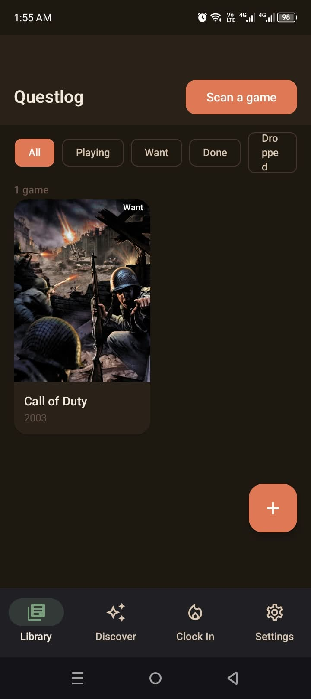
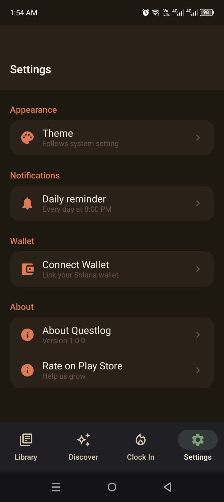
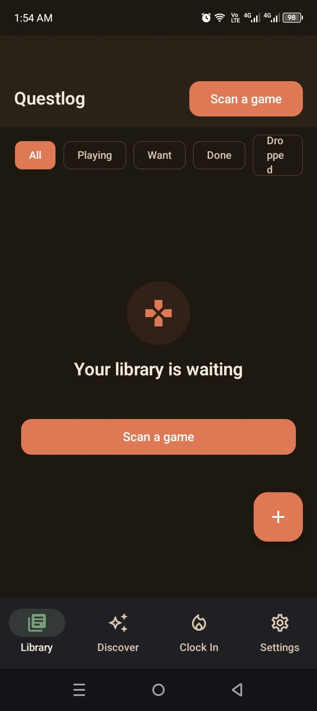
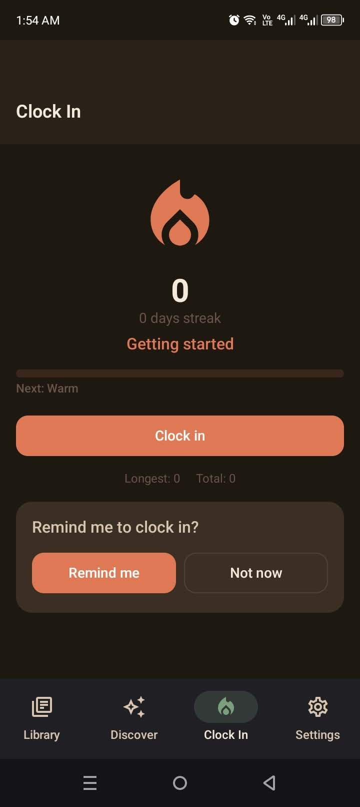

# Questlog

Questlog — Your verified gaming history. Save any game the moment you discover it, prove your completions on-chain. Letterboxd for gaming, built for Solana Mobile.

**📲 Download the app:** [questlog-v1.1.0.apk](https://github.com/hybirdvault-dot/questlog/releases/download/v1.1.0/questlog-v1.1.0.apk) (signed release, Android 8.0+) — or see the [latest release](https://github.com/hybirdvault-dot/questlog/releases/latest). Install and open; no account needed, the wallet only appears if you want on-chain proof.

## The core loop

1. See a game you like — screenshot it (or copy its link) in any app.
2. Share it straight into Questlog from the system share sheet.
3. Questlog reads the screenshot on-device (OCR, no upload) and matches it against RAWG.
4. Add it to your library — free, no wallet, no account.
5. Mark it completed and rate it when you're done.
6. Verify the completion on-chain via Phantom — a permanent, verifiable Proof of Play.

Every day, tap **Clock In** to keep your streak alive (Warm → Flamekeeper → Inferno → Legend).

## Proof-of-Play v1 — open spec

A verified completion is a Solana transaction carrying a single Memo v2 instruction. The memo is a UTF-8 JSON string (not base58/base64 — those are used only for the transaction wire format and signature display):

```json
{ "v": 1, "app": "questlog", "title": "Palworld", "rawgId": 718135, "completedAt": 1760000000, "rating": 4.5 }
```

- Memo program: `MemoSq4gqABAXKb96qnH8TysNcWxMyWCqXgDLGmfcHr` (Memo v2)
- `completedAt` is Unix epoch seconds; `rating` is the player's 1–5 rating; `rawgId` is the RAWG game id.
- RPC: the transaction is built against the latest finalized blockhash, signed by the wallet (Mobile Wallet Adapter), sent, and polled until `finalized`.

## Why it wins

| Criteria | Feature |
|---|---|
| Stickiness | Clock In + streak tiers (Warm, Flamekeeper, Inferno, Legend) give a daily reason to return. |
| UX | A walletless, cozy capture → library flow with zero blockchain jargon. |
| Innovation | The screenshot → OCR → on-chain Proof-of-Play pipeline turns an everyday screenshot into a verifiable achievement. |
| Presentation | A tight, honest 60-second demo — capture a game, complete it, verify it. |

## How to use it (install & play)

1. **Get the app:** download [`questlog-v1.1.0.apk`](https://github.com/hybirdvault-dot/questlog/releases/download/v1.1.0/questlog-v1.1.0.apk) on your Android phone (8.0+).
2. **Install:** open the file → allow "install from unknown sources" if asked. No account, no sign-up.
3. **Add your first game** three ways:
   - **Scan:** tap "Scan a game" → point your camera at a game title/poster
   - **Share:** screenshot any game in TikTok/YouTube → share → Questlog
   - **Search:** Discover tab → type a title
4. **Build your collection:** set status (Want/Playing/Completed/Dropped), rate 1–5 stars, add notes. Free and unlimited — no wallet needed.
5. **Prove a completion:** open a Completed game → tap **"Verify this achievement"** → Phantom signs → your achievement is permanent on Solana → "✓ Verified on Solana" badge + a real explorer link.
6. **Stay consistent:** Clock In tab → tap **Clock in** every day → grow your streak (Warm → Flamekeeper → Inferno → Legend) and watch the calendar fill with your history.

## APIs used

| API / service | What it powers | Key | Docs |
|---|---|---|---|
| **RAWG Video Games API** | All game data: search, covers, release years, platforms, ratings, descriptions | free key ([rawg.io/apidocs](https://rawg.io/apidocs)) → `local.properties` | [RAWG docs](https://rawg.io/apidocs) |
| **Solana (devnet)** | Proof of Play: memo transactions via the Memo v2 program (`MemoSq4gqABAXKb96qnH8TysNcWxMyWCqXgDLGmfcHr`) | none (public RPC `https://api.devnet.solana.com`) | [Solana RPC](https://solana.com/docs/core) |
| **Mobile Wallet Adapter (MWA)** | Phantom connection & transaction signing (Solana Mobile standard) | none | [MWA docs](https://docs.solanamobile.com/mobile-wallet-adapter/what-is-mwa) |
| **Google ML Kit Text Recognition** | On-device OCR — screenshots/camera are never uploaded | none (on-device) | [ML Kit](https://developers.google.com/ml-kit/vision/text-recognition) |
| **Supabase (optional, feed feature)** | Community feed posts + image storage via PostgREST | `SUPABASE_URL`/`SUPABASE_ANON_KEY` in `local.properties` | [Supabase REST](https://supabase.com/docs/guides/api) |

**Network privacy:** only game lookups (RAWG), your signed Proof-of-Play transaction (Solana), and optional feed posts leave the device. OCR runs entirely on-device.

## Proof-of-Play v1 — open spec

A verified completion is a Solana transaction carrying a single Memo v2 instruction. The memo is a UTF-8 JSON string (base58/base64 are used only for the transaction wire format and signature display):

```json
{ "v": 1, "app": "questlog", "title": "Palworld", "rawgId": 718135, "completedAt": 1760000000, "rating": 4.5 }
```

- `v` — format version (1) · `app` — issuer ("questlog") · `title` — human-readable (so the explorer shows a readable credential)
- `rawgId` — [RAWG](https://rawg.io) game id (portable) · `completedAt` — Unix seconds (UTC) · `rating` — 0–5 stars (nullable)
- Memo program: `MemoSq4gqABAXKb96qnH8TysNcWxMyWCqXgDLGmfcHr` (Memo v2) · encoding: UTF-8 via `encodeToByteArray()`
- Explorer template: `https://explorer.solana.com/tx/<SIGNATURE>?cluster=devnet`
- **This block is the spec** — any tracker can parse and verify it. That's the point: your completions outlive our app.

## Why it wins

| Criterion (25% each) | Questlog |
|---|---|
| Stickiness & PMF | Daily Clock In + streak tiers + calendar history + one gentle reminder. Collections compound — free forever. |
| User Experience | Cozy cream/terracotta design, walletless core, zero jargon in UI, haptics + confetti, friendly failure states everywhere. |
| Innovation | The screenshot/scan → OCR → **on-chain Proof of Play** pipeline — no game tracker does this. Open memo format = protocol thinking. |
| Presentation | 60-second honest demo: real device, real timings, real devnet transaction with an openable explorer link. |

**Why blockchain?** *"It's a notarized credential, not a referee. The chain proves when you claimed it, that the claim can't be forged or backdated, and that it's portable — it outlives our app."*

## How to build (developers)

```bash
# JDK 17 + Android SDK 35 required
cp local.properties.example local.properties   # add RAWG_API_KEY=<your key>
./gradlew assembleDebug
# low-RAM boxes: ./gradlew --no-build-cache --max-workers=1 --no-watch-fs assembleDebug
```

Full developer briefing (architecture, 7 laws, dependency traps, roadmap): **[HANDOVER.md](HANDOVER.md)** · Submission copy + demo script: **[docs/SUBMISSION.md](docs/SUBMISSION.md)** · Solana spec details: **[docs/VERIFIED-SOLANA-FACTS.md](docs/VERIFIED-SOLANA-FACTS.md)**

## Screenshots

| | | |
|---|---|---|
|  |  |  |
|  |  |  |

**🎬 60-second demo video:** [questlog-demo.mp4](questlog-demo.mp4) — capture → library → complete → on-chain proof → daily streak.

## Roadmap (deliberately deferred)

Questlog is free forever — no paid tier is planned. Coming next: the Proof-of-Play social feed (every post carries its real transaction), badge wall, home-screen widget, onboarding. Most apps add a blockchain feature; we use the blockchain **as** the backend — auth, audit and integrity are native, so we deleted those systems by design.

## License

Apache 2.0 — see [LICENSE](LICENSE) and [THIRD_PARTY_NOTICES.md](THIRD_PARTY_NOTICES.md). Built on the shoulders of Now in Android, Mihon, ML Kit samples, and the Solana Kotlin Compose scaffold (patterns).
